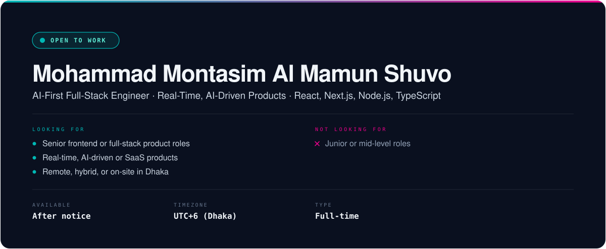

<!--
    Montasim's GitHub Profile README

    Author    : Mohammad Montasim Al Mamun Shuvo
    Contact   : montasimmamun@gmail.com
    Portfolio : https://montasim.dev

    The Open to Work card is generated by scripts/build-open-to-work-card.mjs.
-->

<!-- Open to Work card (scripts/build-open-to-work-card.mjs; delete it when no longer looking) -->
<picture>
  <source media="(prefers-color-scheme: dark)" srcset="assets/profile/open-to-work-dark.svg" />
  <source media="(prefers-color-scheme: light)" srcset="assets/profile/open-to-work-light.svg" />
  
</picture>

 

<!-- About, in the style of the CC0 "Editorial Card" template (beydemirfurkan/awesome-github-profile) -->
## About

> *I build software that has to work under real conditions: live video, in-browser computer vision, long sessions, flaky networks.*

 

## Tech stack

<picture>
  <source media="(prefers-color-scheme: dark)" srcset="https://skillicons.dev/icons?i=ts%2Cjs%2Cnodejs%2Creact%2Cnextjs%2Cnestjs%2Cexpress%2Celectron%2Credux%2Ctailwind%2Cthreejs%2Cvite%2Cprisma%2Cpostgres%2Cmysql%2Csqlite%2Cmongodb%2Credis%2Csupabase%2Cfirebase%2Cazure%2Caws%2Cdocker%2Cgithubactions%2Cjest%2Cvitest&perline=13&theme=dark" />
  <source media="(prefers-color-scheme: light)" srcset="https://skillicons.dev/icons?i=ts%2Cjs%2Cnodejs%2Creact%2Cnextjs%2Cnestjs%2Cexpress%2Celectron%2Credux%2Ctailwind%2Cthreejs%2Cvite%2Cprisma%2Cpostgres%2Cmysql%2Csqlite%2Cmongodb%2Credis%2Csupabase%2Cfirebase%2Cazure%2Caws%2Cdocker%2Cgithubactions%2Cjest%2Cvitest&perline=13&theme=light" />
  
</picture>

 
 

## GitHub stats

<picture>
  <source media="(prefers-color-scheme: dark)" srcset="https://github-stats-extended.vercel.app/api?username=montasim&custom_title=GitHub%20stats&show_icons=true&include_all_commits=true&rank_icon=percentile&hide=contribs&line_height=29&card_width=500&hide_border=true&bg_color=00000000&title_color=00B8B5&icon_color=EB008B&text_color=C9D1D9" />
  <source media="(prefers-color-scheme: light)" srcset="https://github-stats-extended.vercel.app/api?username=montasim&custom_title=GitHub%20stats&show_icons=true&include_all_commits=true&rank_icon=percentile&hide=contribs&line_height=29&card_width=500&hide_border=true&bg_color=00000000&title_color=008280&icon_color=C50074&text_color=24292F" />
  
</picture>
<picture>
  <source media="(prefers-color-scheme: dark)" srcset="https://github-stats-extended.vercel.app/api/top-langs?username=montasim&layout=compact&langs_count=8&card_width=500&hide_border=true&bg_color=00000000&title_color=00B8B5&text_color=C9D1D9" />
  <source media="(prefers-color-scheme: light)" srcset="https://github-stats-extended.vercel.app/api/top-langs?username=montasim&layout=compact&langs_count=8&card_width=500&hide_border=true&bg_color=00000000&title_color=008280&text_color=24292F" />
  
</picture>

 

<!-- Footer -->

   
  

